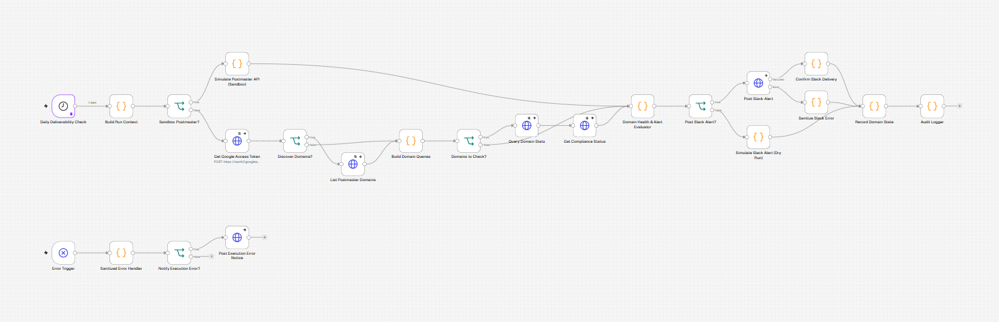
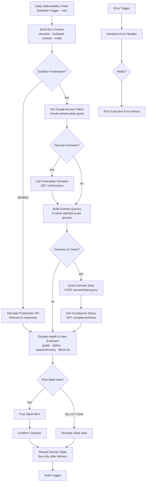

# n8n-google-postmaster-tools-deliverability-alert-bot

**A daily Gmail deliverability watchdog: Google Postmaster Tools API v2 → a per-domain health grade (HIGH / MEDIUM / LOW / BAD) → a Slack Block Kit alert when a sending domain drops to Medium or Low, spikes in spam complaints, starts getting rejected for reputation, or has TLS or authentication problems.**

I built this n8n workflow for outbound and lifecycle teams who check Postmaster Tools only after reply rates collapse. Every morning it queries each of your sending domains and compares today's signals with your thresholds and yesterday's grade. It tells the team in Slack what changed, why, and what to do first, and stays quiet when nothing did.

> **Safe by default.** `SANDBOX_MODE=true` and `DRY_RUN=true`. Out of the box, the workflow runs only against a pinned fictional run with seven domains. It makes no Google or Slack calls until you turn both switches off.

Built by DH Robin · dhRobin Systems · MIT licensed.

---

## Table of Contents

1. [Why this exists](#1-why-this-exists)
2. [Architecture](#2-architecture)
3. [Repository layout](#3-repository-layout)
4. [Quick start](#4-quick-start)
5. [Important: Google retired Domain & IP Reputation](#5-important-google-retired-domain--ip-reputation)
6. [Postmaster Tools API authentication](#6-postmaster-tools-api-authentication)
7. [API calls & metrics](#7-api-calls--metrics)
8. [Evaluation logic: Medium/Low grades and spam spikes](#8-evaluation-logic-mediumlow-grades-and-spam-spikes)
9. [Alert rules & Slack message](#9-alert-rules--slack-message)
10. [Environment variables](#10-environment-variables)
11. [Node configuration](#11-node-configuration)
12. [Testing stages](#12-testing-stages)
13. [Security & privacy model](#13-security--privacy-model)
14. [Troubleshooting](#14-troubleshooting)
15. [Known limitations](#15-known-limitations)
16. [Disclaimer & license](#16-disclaimer--license)

---

## 1. Why this exists

Gmail deliverability problems rarely arrive without warning. Spam complaints creep up over a week, Gmail starts rejecting a slice of mail for reputation, or a new sending tool goes live without DKIM. All of it is visible in Postmaster Tools, but nobody opens it every day. This bot does, and:

- **grades every domain** the same way every day;
- **alerts on change, not on noise:** a drop in grade, a fresh spike, a recovery, or a reminder every few days while a domain stays degraded;
- **explains the alert:** the numbers behind the grade and the first fix to try;
- **remembers yesterday,** so a domain that's been Low all week doesn't trigger a new alarm every morning.

## 2. Architecture





| Required component | Nodes |
|---|---|
| 1 · Schedule Trigger | `Daily Deliverability Check` (cron `17 7 * * *`, pinned fictional run) |
| 2 · Google Postmaster Tools API Engine | `Get Google Access Token`, `List Postmaster Domains`, `Build Domain Queries`, `Query Domain Stats`, `Get Compliance Status` (sandbox: `Simulate Postmaster API`) |
| 3 · Domain Health & Alert Evaluator | `Domain Health & Alert Evaluator` |
| 4 · Slack Deliverability Alert Dispatcher | `Post Slack Alert`, `Confirm Slack Delivery`, `Sanitize Slack Error` (dry run: `Simulate Slack Alert`) |
| 5 · Audit Logger & Sanitized Error Handler | `Record Domain State`, `Audit Logger`, `Sanitized Error Handler` |

The sandbox simulator returns the exact v2 response shapes, so a sandbox run exercises the same parsing, grading and Slack code as production.

## 3. Repository layout

```
n8n-google-postmaster-tools-deliverability-alert-bot/
├── README.md        ← this file
├── workflow.json    ← import into n8n (inactive, sandbox defaults, pinned fixture run)
├── DISCLAIMER.md
└── LICENSE          ← MIT
```

All logic lives in Code nodes inside `workflow.json`. There are no community nodes and no stored n8n credentials. Every secret comes from an environment variable.

## 4. Quick start

1. In n8n, go to **Workflows → Import from File** and select `workflow.json`. The workflow imports **inactive**.
2. Open it and click **Execute Workflow**. The trigger replays one pinned fictional run.
3. Open **Domain Health & Alert Evaluator**. You should see seven evaluations, matching [Stage 1](#stage-1--sandbox-pinned-fixtures-no-network), and a Block Kit message.
4. Open **Audit Logger** for the masked per-domain records.

### n8n platform prerequisites

| Setting | Why |
|---|---|
| `N8N_BLOCK_ENV_ACCESS_IN_NODE=false` | Code nodes and expressions read configuration through `$env`. If access is blocked, the helpers fall back to the safe defaults. |
| `NODE_FUNCTION_ALLOW_BUILTIN=crypto` | Run IDs and domain masking in the audit log. |
| Workflow **Settings → Timezone** | The schedule runs in the workflow timezone (UTC by default). |
| Settings → Error Workflow = this workflow | Activates the sanitized error branch. |

## 5. Important: Google retired Domain & IP Reputation

I checked the current state of Postmaster Tools before building this, and it changes what a "Medium or Low reputation" alert can mean:

- **The API moved to v2.** The **Postmaster Tools API v2** became generally available on 3 February 2026. It replaces v1's `trafficStats` with `domains.domainStats.query`, and adds `domains.getComplianceStatus` and batch queries. Google says the **v1 API will be retired**.
- **Reputation isn't in v2.** The **Domain Reputation and IP Reputation dashboards were not carried into v2**, and the v2 API has **no reputation fields**. The old `domainReputation` / `ipReputations` values (HIGH, MEDIUM, LOW, BAD) aren't available any more.
- **Reputation still shows up in delivery errors.** Reputation-driven rejections appear as the reasons `low_domain_reputation` and `low_ip_reputation`.

So this bot computes its own **derived health grade** with the familiar labels **HIGH / MEDIUM / LOW / BAD**, from the signals v2 still exposes (section 8). Every Slack alert says so in its footer. Nobody should read it as Google's own reputation score.

## 6. Postmaster Tools API authentication

The v2 API reads private domain data, so it needs **OAuth 2.0 user authorization**. An API key on its own can't authorize it.

| Variable | Purpose |
|---|---|
| `GOOGLE_OAUTH_CLIENT_ID`, `GOOGLE_OAUTH_CLIENT_SECRET` | OAuth client (type *Desktop* or *Web*) in a Google Cloud project with the **Gmail Postmaster Tools API** enabled |
| `GOOGLE_OAUTH_REFRESH_TOKEN` | Refresh token for a Google account that has access to the domains in Postmaster Tools |
| `GOOGLE_POSTMASTER_API_KEY` | **Optional.** Appended as `key=` for quota attribution to your project. Never needed for authorization. |

**Scopes (least privilege):**

- `https://www.googleapis.com/auth/postmaster.traffic.readonly` covers `domainStats.query` and `getComplianceStatus`. That's all the default mode needs.
- `https://www.googleapis.com/auth/postmaster.domain` is required **only** for `POSTMASTER_DISCOVER_DOMAINS=true` (`GET /v2/domains`). Google describes it as *view and manage*, so I keep it off by default and list domains in `POSTMASTER_DOMAINS` instead.

**Getting a refresh token** (one-time, on a trusted machine): use Google's OAuth 2.0 Playground with *your own* client ID and secret ("Use your own OAuth credentials"), authorize the scope above, exchange the code, and copy the refresh token into your n8n environment. Then remove the Playground redirect URI from your client if you don't need it. Consent screens in *Testing* status issue refresh tokens that expire after 7 days. Publish the app, or use an internal Workspace app, for a token that lasts.

The `Get Google Access Token` node exchanges the refresh token at `https://oauth2.googleapis.com/token` on every run. The short-lived access token is only ever read inside the HTTP header expressions. **Alternative:** replace that node with an n8n *Google OAuth2 API* credential on the three HTTP nodes, if your team prefers stored credentials.

## 7. API calls & metrics

| Step | Request |
|---|---|
| Token | `POST https://oauth2.googleapis.com/token` (`grant_type=refresh_token`) |
| Domains (optional) | `GET https://gmailpostmastertools.googleapis.com/v2/domains?pageSize=200` (only verified domains are used) |
| Stats | `POST https://gmailpostmastertools.googleapis.com/v2/domains/{domain}/domainStats:query` |
| Compliance | `GET https://gmailpostmastertools.googleapis.com/v2/domains/{domain}/complianceStatus` |

Query body, one per domain, covering the last `LOOKBACK_DAYS` (8). Postmaster data usually lags a day or two.

```json
{
  "metricDefinitions": [
    { "name": "spam_rate",      "baseMetric": { "standardMetric": "SPAM_RATE" } },
    { "name": "auth_spf",       "baseMetric": { "standardMetric": "AUTH_SUCCESS_RATE" },   "filter": "auth_type = \"spf\"" },
    { "name": "auth_dkim",      "baseMetric": { "standardMetric": "AUTH_SUCCESS_RATE" },   "filter": "auth_type = \"dkim\"" },
    { "name": "auth_dmarc",     "baseMetric": { "standardMetric": "AUTH_SUCCESS_RATE" },   "filter": "auth_type = \"dmarc\"" },
    { "name": "tls_inbound",    "baseMetric": { "standardMetric": "TLS_ENCRYPTION_RATE" }, "filter": "traffic_direction = \"inbound\"" },
    { "name": "err_total",      "baseMetric": { "standardMetric": "DELIVERY_ERROR_RATE" } },
    { "name": "err_rep_domain", "baseMetric": { "standardMetric": "DELIVERY_ERROR_RATE" }, "filter": "error_type = \"reject\" AND error_reason = \"low_domain_reputation\"" },
    { "name": "err_rep_ip",     "baseMetric": { "standardMetric": "DELIVERY_ERROR_RATE" }, "filter": "error_type = \"reject\" AND error_reason = \"low_ip_reputation\"" },
    { "name": "err_temp",       "baseMetric": { "standardMetric": "DELIVERY_ERROR_RATE" }, "filter": "error_type = \"temp_fail\"" }
  ],
  "timeQuery": { "dateRanges": { "dateRanges": [ { "start": { "year": 2026, "month": 11, "day": 8 }, "end": { "year": 2026, "month": 11, "day": 15 } } ] } },
  "aggregationGranularity": "DAILY",
  "pageSize": 200
}
```

- **Response:** `domainStats[]`, each with `{ name, metric, date: { year, month, day }, value: { doubleValue | floatValue | intValue } }`.
- **Rate parsing:** rates are read as ratios (0–1). Any value above 1 is treated as a percentage and divided by 100, which guards against a unit change.
- **Compliance:** `complianceData.rowData[].{ requirement, status.status }` (`COMPLIANT` / `NEEDS_WORK`) and `complianceData.deliverabilityStatusVerdict.{ state.status, reason }`.
- **Volume floor:** domains with too little Gmail traffic return no rows and are graded `no_data`.

The requirement and reason names in the fixtures are illustrative. The evaluator displays whatever names Google returns.

## 8. Evaluation logic: Medium/Low grades and spam spikes

Each domain starts at **HIGH**. Every rule that fires can only lower the grade, and the **worst rule wins**. All thresholds are environment variables.

| Signal (latest day with data) | MEDIUM | LOW | BAD |
|---|---|---|---|
| Spam rate (`SPAM_RATE`) | ≥ `SPAM_RATE_WARN` **0.10 %** | ≥ `SPAM_RATE_CRITICAL` **0.30 %** | ≥ `SPAM_RATE_SEVERE` **0.60 %** |
| Rejects for `low_domain_reputation` | > `REPUTATION_REJECT_WARN` **0** | ≥ `REPUTATION_REJECT_CRITICAL` **1 %** | ≥ `REPUTATION_REJECT_SEVERE` **5 %** |
| Rejects for `low_ip_reputation` | > 0 | ≥ 1 % | ≥ 5 % |
| SPF / DKIM / DMARC success | < `AUTH_SUCCESS_MIN` **98 %** | — | — |
| TLS encryption, inbound to Gmail | < `TLS_ENCRYPTION_MIN` **99 %** | < `TLS_ENCRYPTION_CRITICAL` **90 %** | — |
| All delivery errors | ≥ `DELIVERY_ERROR_WARN` **2 %** | ≥ `DELIVERY_ERROR_CRITICAL` **10 %** | — |
| Compliance requirement `NEEDS_WORK` | any | — | — |
| Deliverability verdict `NEEDS_WORK` | yes | — | — |

The 0.10 % and 0.30 % spam-rate lines follow Google's published guidance for bulk senders: stay below 0.10 %, and never reach 0.30 %.

**Spam spike:** the latest spam rate is ≥ `SPAM_SPIKE_MULTIPLIER` (2×) the average of the earlier days in the window, needs at least three of them, and must be at least `SPAM_SPIKE_MIN_RATE` (0.05 %). A spike is reported even when the grade doesn't change, and only once per data day.

**Statuses:**
- `ok`: graded.
- `no_data`: no rows; not an alert unless `ALERT_ON_NO_DATA=true` and the domain had data before.
- `error`: the API call failed; always reported in an "Couldn't check" section.

Fixture example, `outbound.globex-fixture.example`. The grade is **LOW**, because two rules hit LOW: spam 0.38 % and 2.1 % reputation rejects. Five more rules hit MEDIUM: DMARC 91 %, TLS 96.2 %, delivery errors 3.4 %, two requirements needing work, and the deliverability verdict.

## 9. Alert rules & Slack message

The evaluator compares each domain with its stored state from the last successful run:

| Reason | When |
|---|---|
| `degraded` / `degraded_first_check` | The grade is MEDIUM or worse and lower than last time (or on the first check) |
| `spam_spike` | A new spike, even without a grade change |
| `still_degraded` | Still MEDIUM or worse, and the last alert was ≥ `REPEAT_ALERT_DAYS` (3) ago |
| `recovered` | Back to HIGH after MEDIUM or worse (`NOTIFY_ON_RECOVERY=true`) |
| `api_error` | The stats call failed (permissions, quota, auth), or no domains are configured |

All alerts for a run go into **one** Slack message:

- **Header:** coloured by the worst grade (🟡 MEDIUM, 🟠 LOW, 🔴 BAD).
- **Context line:** check date, the date the data runs through, the number of domains, and the mode.
- **One section per degraded domain** (up to 10): the transition ("dropped HIGH → MEDIUM"), spam rate against its average, reputation rejects, SPF/DKIM/DMARC, TLS and delivery errors. Then every finding, and up to three first actions such as "Gmail is rejecting on domain reputation: cut volume, send only to engaged recipients, warm back up slowly".
- **Recoveries** and **"Couldn't check"** sections.
- An **Open Postmaster Tools** button, and a footer stating that the grade is derived.

Options:
- `SLACK_MENTION_ON_LOW`, for example `<!subteam^YOUR_GROUP_ID>`, mentions a group when any domain is LOW or BAD.
- `SLACK_MASK_DOMAINS=true` shortens domain names in Slack (`ne•••.acme-fixture.example`) for shared channels.

**State** is written only in live mode, and only when no alert was due or Slack accepted the message. A failed post is therefore retried the next day.

## 10. Environment variables

Copy this block into your n8n environment and replace every placeholder.

```bash
# ── Safety switches (both must be "false" before anything is posted) ──
SANDBOX_MODE=true
DRY_RUN=true

# ── Google Postmaster Tools API v2 (OAuth 2.0) ──
GOOGLE_OAUTH_CLIENT_ID=YOUR_GOOGLE_OAUTH_CLIENT_ID
GOOGLE_OAUTH_CLIENT_SECRET=YOUR_GOOGLE_OAUTH_CLIENT_SECRET
GOOGLE_OAUTH_REFRESH_TOKEN=YOUR_GOOGLE_OAUTH_REFRESH_TOKEN
# Optional quota attribution only
GOOGLE_POSTMASTER_API_KEY=YOUR_GOOGLE_POSTMASTER_API_KEY
POSTMASTER_API_BASE_URL=https://gmailpostmastertools.googleapis.com
# Comma-separated sending domains registered in Postmaster Tools
POSTMASTER_DOMAINS=YOUR_SENDING_DOMAIN.example
# true needs the postmaster.domain scope
POSTMASTER_DISCOVER_DOMAINS=false
MAX_DOMAINS_PER_RUN=50
LOOKBACK_DAYS=8

# ── Evaluation thresholds (ratios: 0.001 = 0.10 %) ──
SPAM_RATE_WARN=0.001
SPAM_RATE_CRITICAL=0.003
SPAM_RATE_SEVERE=0.006
SPAM_SPIKE_MULTIPLIER=2
SPAM_SPIKE_MIN_RATE=0.0005
REPUTATION_REJECT_WARN=0
REPUTATION_REJECT_CRITICAL=0.01
REPUTATION_REJECT_SEVERE=0.05
AUTH_SUCCESS_MIN=0.98
TLS_ENCRYPTION_MIN=0.99
TLS_ENCRYPTION_CRITICAL=0.9
DELIVERY_ERROR_WARN=0.02
DELIVERY_ERROR_CRITICAL=0.1

# ── Alerting ──
SLACK_WEBHOOK_URL=YOUR_SLACK_WEBHOOK_URL
REPEAT_ALERT_DAYS=3
NOTIFY_ON_RECOVERY=true
ALERT_ON_NO_DATA=false
SLACK_MASK_DOMAINS=false
SLACK_MENTION_ON_LOW=
SLACK_NOTIFY_ON_MONITOR_ERROR=true

# ── Audit ──
AUDIT_MASK_DOMAINS=true
AUDIT_LOG_TO_STDOUT=true
AUDIT_RING_BUFFER_SIZE=400

# ── n8n platform ──
N8N_BLOCK_ENV_ACCESS_IN_NODE=false
NODE_FUNCTION_ALLOW_BUILTIN=crypto
```

Flags accept only `true/1/yes/on` or `false/0/no/off`. Anything else keeps the safe default. Values starting with `YOUR_` are ignored (domains, API key). Keep comments on their own lines, because Docker env files don't support inline comments.

## 11. Node configuration

| Node | Type | Key settings |
|---|---|---|
| Daily Deliverability Check | Schedule Trigger v1.2 | cron `17 7 * * *` (workflow timezone); edit the node to change it |
| Build Run Context | Code v2, all items | domains, window, mode |
| Sandbox Postmaster? / Discover Domains? / Domains to Check? / Post Slack Alert? | IF v2.2 | strict, case-sensitive |
| Get Google Access Token | HTTP Request v4.2 | POST form-urlencoded refresh-token grant · full response · never error · 3 tries |
| List Postmaster Domains / Query Domain Stats / Get Compliance Status | HTTP Request v4.2 | `Authorization: Bearer {{ $('Get Google Access Token').first().json.body.access_token }}` · full response · never error · 3 tries |
| Build Domain Queries | Code v2, all items | one item per domain · 9 metric definitions |
| Domain Health & Alert Evaluator | Code v2, all items | sections 8–9 |
| Post Slack Alert | HTTP Request v4.2 | `continueErrorOutput` → Sanitize Slack Error · no auto-retry |
| Record Domain State | Code v2, each item | `postmasterState` in static data (live only) |
| Audit Logger | Code v2, all items | run record + one record per domain · `postmasterAudit` ring buffer (not in sandbox) |
| Error Trigger → Sanitized Error Handler | Error Trigger v1 + Code v2 | redacted summary, optional Slack notice |

## 12. Testing stages

### Stage 1 · Sandbox (pinned fixtures, no network)

`SANDBOX_MODE=true`, `DRY_RUN=true`. The pinned run uses the fixture date 2026-11-16 and yesterday's stored grades:

| Domain (fictional) | Yesterday | Today | Alert |
|---|---|---|---|
| mail.acme-fixture.example | HIGH | **HIGH** (spam 0.03 %) | none |
| news.acme-fixture.example | HIGH | **MEDIUM** (spam 0.14 %, spike vs 0.05 %) | `degraded` |
| outbound.globex-fixture.example | MEDIUM | **LOW** (spam 0.38 %, 2.1 % reputation rejects, DMARC 91 %, TLS 96 %) | `degraded` |
| promo.initech-fixture.example | LOW | **HIGH** | `recovered` |
| tiny.umbrella-fixture.example | — | `no_data` (low volume) | none |
| legacy.hooli-fixture.example | — | `error` (403 permission denied) | `api_error` |
| bulk.stark-fixture.example | BAD | **BAD**, alerted yesterday | none (repeat in 3 days) |

All domains use the reserved `.example` suffix. Every metric value, compliance result and date is fictional.

### Stage 2 · Shadow (real Postmaster data, Slack simulated)

`SANDBOX_MODE=false`, `DRY_RUN=true`. Set the OAuth variables and `POSTMASTER_DOMAINS`, then execute the workflow manually. Check `Query Domain Stats` for HTTP 200 and the `domainStats` rows, then the grades in the evaluator. Nothing is posted, and state isn't stored.

### Stage 3 · Live alerts

`DRY_RUN=false`, posting to a test Slack channel. Execute the workflow twice: the second run should be quiet unless something changed. Temporarily lower `SPAM_RATE_WARN` to force an alert, then restore it. Make the workflow its own **Error Workflow** and break the refresh token to see the sanitized notice.

### Stage 4 · Production

Activate the workflow, point Slack at your deliverability channel, and tune the thresholds after a couple of weeks of history.

## 13. Security & privacy model

- **No secrets in the workflow.** OAuth client and refresh token, the optional API key and the Slack webhook come from `$env`. The JSON contains only placeholders and fictional `.example` domains.
- **Least privilege.** Read-only `postmaster.traffic.readonly` by default. Discovery, which needs the broader domain scope, is opt-in.
- **Read-only against Google.** The bot never creates, verifies or deletes domains, and never manages users.
- **Domain data protected in logs.** Audit records replace domain names with `dom_<sha256-prefix>.<tld>` (`AUDIT_MASK_DOMAINS=true`) and hold grades, metric values, finding kinds and alert reasons only. Slack can mask domains too (`SLACK_MASK_DOMAINS=true`).
- **Redaction.** Keys matching `authorization|token|secret|password|api key|cookie|signature|webhook url` are replaced. These are scrubbed from every string, including error messages:
  - Google access tokens (`ya29.`), refresh tokens (`1//`), API keys (`AIza…`) and OAuth client secrets (`GOCSPX-`);
  - JWTs and Bearer tokens;
  - Slack webhook URLs and `key=` query values.
- **Sanitized errors.** The error branch drops stack traces, request options and bodies.
- **Restrict n8n execution data.** The token node's response holds a short-lived access token. Limit who can open executions, and set a short retention period.

## 14. Troubleshooting

| Symptom | Likely cause | Fix |
|---|---|---|
| Token call returns `invalid_grant` | Refresh token expired (consent screen in Testing) or revoked | Publish the consent screen or use an internal app; mint a new token |
| Stats calls return 403 `PERMISSION_DENIED` | The authorizing account has no access to the domain in Postmaster Tools | Add the account to the domain in Postmaster Tools, or use an account that verified it |
| 403 `insufficient scopes` on `/v2/domains` | Discovery on, but only the traffic scope was granted | Grant `postmaster.domain`, or turn discovery off and list domains |
| Every domain `no_data` | Low Gmail volume, data lag, or the window is too short | Raise `LOOKBACK_DAYS`; low-volume domains don't get statistics |
| 404 on `domainStats:query` | Using v1 paths or a domain not registered | Check `POSTMASTER_API_BASE_URL` and that the domain is added in Postmaster Tools |
| Grades look 100× off | Rate unit change | Rates above 1 are auto-scaled; check the raw `value` in `Query Domain Stats` |
| Alerts every day for the same domain | `REPEAT_ALERT_DAYS=1`, or state isn't being stored (dry run, Slack failures) | Check `stateHeldReason` in the audit log |
| No alerts ever | Thresholds too loose, or `DRY_RUN=true` | Check the evaluator output; temporarily lower a threshold |
| Expecting the old reputation score | Retired by Google | See section 5. The grade is derived |

## 15. Known limitations

- **Gmail only.** Postmaster Tools covers mail to personal Gmail accounts. Pair it with Microsoft SNDS and Yahoo's Sender Hub for other mailbox providers.
- **No official reputation score** (section 5). The grade is my derived indicator.
- **One page per query.** 9 metrics × up to 30 days fits in one 200-row page, and `nextPageToken` isn't followed.
- **Compliance names** are shown as returned by Google. The fixtures use illustrative names.
- **Static data isn't transactional.** Don't run two copies of this workflow at once.

---

## 16. Disclaimer & license

### ⚠️ Disclaimer & Liability Limitation

Use at your own risk. The code, workflows, and scripts in this repository (`n8n-google-postmaster-tools-deliverability-alert-bot`) are provided for educational and architectural demonstration purposes.

* **No Liability:** The author and dhRobin Systems accept no responsibility or liability for any direct, indirect, incidental, or consequential damages that result from using, misusing, or deploying these scripts. That includes missed, late or incorrect deliverability alerts, decisions made from a derived health grade, and lost email revenue.
* **No Warranty:** All software, n8n JSON blueprints and JavaScript modules are provided "AS IS", without warranty of any kind, express or implied. This includes, but is not limited to, warranties of merchantability, fitness for a particular purpose, and non-infringement.
* **Production Testing Required:** Always test thoroughly in an isolated staging environment, such as a test Google Cloud project, a non-critical Postmaster domain and a test Slack channel, with `SANDBOX_MODE=true` and `DRY_RUN=true` enabled, before you connect live Google or Slack credentials. Treat every grade and alert as a prompt to investigate in Postmaster Tools, not as Google's own assessment.
* **Third-Party APIs & Compliance:** You alone are responsible for complying with the terms of service, rate limits, data privacy regulations (GDPR/CCPA), sender requirements, and security policies of Google, Slack and any connected services. That includes protecting OAuth credentials, granting only the scopes you need, keeping domain and traffic data inside appropriate channels, and following Google's sender guidelines.

The full disclaimer is also available in [DISCLAIMER.md](https://github.com/dhrobinsystems/n8n-google-postmaster-tools-deliverability-alert-bot/blob/main/DISCLAIMER.md).

### License

Released under the MIT License. Copyright (c) 2026 DH Robin (dhRobin Systems). See [LICENSE](https://github.com/dhrobinsystems/n8n-google-postmaster-tools-deliverability-alert-bot/blob/main/LICENSE).

---

Full text: DISCLAIMER.md · Licensed under the MIT License. License: MIT © 2026 DH Robin (dhRobin Systems) · Provided as-is, see the disclaimer.
